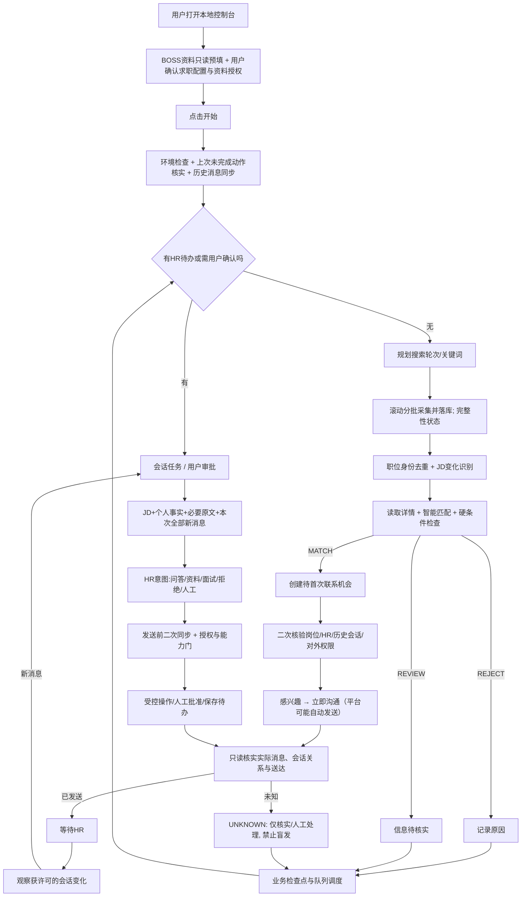
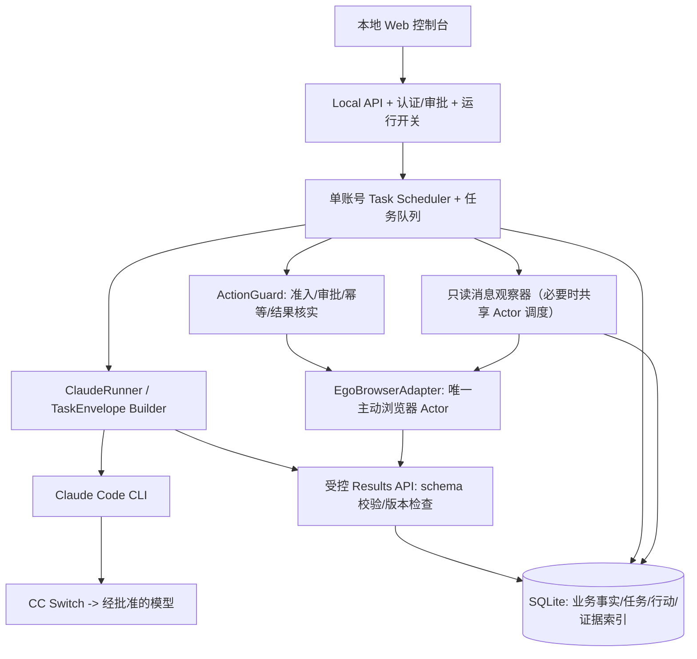

# BOSS 自主求职 Agent｜V1.1 独立审查与正式开发实施方案

> 日期：2026-10-24  
> 依据：用户上传的 `boss-feasibility-v1.1.zip`（00–06 报告、`cases.json`、`evidence_index.md`、`validation-poc/*.mjs`、`evidence/poc_suite.log`）及已确认业务规则。  
> 评价口径：**验证报告中的 PASS、随包可独立复核的证据、可运行代码的实现范围，是三个不同维度。**  
> 交付用途：指导下一阶段本地 Agent 正式开发，不替用户执行 BOSS 对外操作；本次未运行外部 API 或发送招聘消息。

## 0. 决策摘要

**结论：架构设计与非写入功能开发 GO；真实自动对外联系/回复 CONDITIONAL NO-GO，直到相关门禁、外部核实、授权和端到端联调完成。** 不必安排另一轮大型平台探索；把剩余问题转化为开发中的功能验收项与集成门禁。

- 成立的事实：Ego 可阅读部分 BOSS 搜索、JD、聊天、简历；有一个真实岗位实现“感兴趣 → 立即沟通 → BOSS 自动发送平台预设招呼 → 送达”；单向新会话里的资料/联系方式工具被禁用，历史双向会话里部分工具显示可用；Claude CLI 经当前网关和模型可输出 JSON，Node 能写入 SQLite。
- 不成立的泛化：87 项全部真实集成通过、列表全部遍历完成、前置逐岗位首招呼不可能、收到 HR 回复是所有解锁条件的唯一原因、真实 Ego + Claude CLI 一条端到端动作链已跑通、真实崩溃后外部消息核实已跑通。
- 现有 POC 的价值：局部原型与设计验证，可以复用思路和若干基础 SQL；**不能原样作为生产调度器、安全发送网关或恢复模块**。

### 0.1 立即处理的信息安全事项（P0）

上传包中的 `03_ClaudeCLI_CC-Switch_Ego_工程POC报告.md` 和 `validation-poc/poc_suite.mjs` 含完整模型访问密钥；这与 `evidence_index.md`“Token 已脱敏”的叙述矛盾。

**立即撤销/轮换该密钥、检查网关调用记录、删除/清理带密钥的代码和报告副本；若已进版本库还须处理历史与已有克隆副本。** 避免再次粘贴密钥到聊天或报告。新实现使用环境变量或受管密钥配置，日志遮盖敏感值，杜绝将个人简历、HR 消息和认证信息写入通用调试日志。模型网关所属组织需要明确允许个人求职资料处理。

---

## 1. 源码与证据审查

### 1.1 文件完整性与统计一致性

- ZIP 实际包含 **13** 个文件；证据索引列出许多 `evidence/*.log`，但实际随包仅有 `evidence/poc_suite.log`。
- `cases.json` 有 **87** 个条目、全部标注 `PASS`，**54 种不同证据路径中只有 1 种实际存在**；**74 个用例没有可随包打开的对应证据**。因此“87/87 PASS”只能理解为执行者自行填报的判定，不能理解为独立审计完成。
- `cases.json` 按条目计算：**OBSERVED 46、REPLAYED 6、SIMULATED 35**；`01_验证矩阵_逐项结果.md` 统计为 45、8、34，口径不一致。
- `build_cases.mjs` 由一系列写死的 `addCase(..., "PASS", ...)` 生成结果，并非 87 项验证程序的自动结果。开发后必须将实际运行结果和证据链接自动关联，禁止固定构建全部通过状态。

### 1.2 POC 真正验证了什么？

| 范围 | 实际代码证据 | 允许的判断 | 不能推导的结论 |
|---|---|---|---|
| Claude CLI/模型 | `poc_suite.mjs` 启动一次 `claude.exe` 并解析结构化响应 | 当前环境可做简单模型判断 | 完整 Ego 工具调用、长任务稳定性、结构化流式工具事件、超时取消已通过 |
| SQLite 幂等 | `db.mjs` 对 `events.event_id` 使用唯一键及 `ON CONFLICT DO NOTHING` | 同一测试连接中重复事件不会插第二行 | 语义相异但同事件 ID 的冲突已发现；数据库级全流程事务、恢复已通过 |
| 崩溃恢复 | 测试代码手动将操作设为 `UNKNOWN`，随后直接写为 `VERIFIED_SUCCESS` | 可以存取 UNKNOWN 状态 | 实际杀进程、重启后用 Ego 外部核实、真实 BOSS 发送防重已验证 |
| 检查点/YIELD | 手动写 `JOB_C` 检查点、释放/重获数据库锁 | 可以存一个检查点并演示锁竞争 | 长任务可安全中断、Claude 主动让权、跨进程租约过期恢复已验证 |
| 浏览器 Ego | POC 仅声明架构使用 Ego，未附 Ego 调用实现 | 外部 Antigravity + Ego 有独立页面观察证据 | Claude CLI 在受控服务中确实自主调用 Ego 已通过 |

### 1.3 现有源码必须修的工程问题

| 等级 | 文件/位置 | 问题 | 开发要求 |
|---|---|---|---|
| P0 | `poc_suite.mjs` 约 101–105 行 | 密钥硬编码 | 撤销密钥，改运行时安全注入，日志/报告脱敏 |
| P0 | `db.mjs` 第 4 行 | 数据库默认 `:memory:` | 持久化真实 SQLite 文件、跨进程重启后核实数据存在 |
| P0 | `poc_suite.mjs` 48–56 行 | “崩溃恢复/外部核实”完全人工模拟 | 真实子进程中断、外部只读核实及不可核实的保持 UNKNOWN 测试 |
| P0 | `db.mjs` 118–123 行 | `recordActionOutcome` 可任意从 PREPARED 改为成功，既无合法状态守卫也不校验证据 | 由服务强制状态转移、核验证据类型、操作者及新旧版本 |
| P0 | `poc_suite.mjs` 93–152 行 | 没有 Ego 调用，CLI 只是输出 JSON | 增加只读 `ClaudeRunner → EgoAdapter → 结果回写` 的真实集成用例 |
| P1 | `poc_suite.mjs` 124–126 行 | 贪婪正则从 stdout 抓 JSON，没有 schema 验证 | 使用受支持的结构化响应格式，校验 JSON schema、字段来源及目标 ID |
| P1 | `poc_suite.mjs` 154–165 行 | 不论测试 assert 有 FAIL 与否都 `process.exit(0)` | 有任一失败时非零退出，CI 必须拒绝 |
| P1 | `poc_suite.mjs` 109–150 行 | `spawn` 未处理 error/硬超时/子进程树取消；收集输出无界 | 进程守护、超时、子进程组清理、输出长度限制和日志脱敏 |
| P1 | `db.mjs` 146–160 行 | 浏览器锁无 lease/心跳、故障后可能永久锁住 | 主动租约、过期回收、fencing token、防旧进程继续操作 |
| P1 | `db.mjs` 98–105 行 | assessment 更新不校验已有配置版本，可能覆盖新判定 | 评估不可变版本或乐观并发版本守卫 |
| P1 | `db.mjs` 79–94 行 | 岗位 ON CONFLICT 忽略后续 JD/薪资/HR 变化 | 岗位主表 + 独立发现记录 + JD 快照/版本变化 |
| P1 | `db.mjs` 整体 | 只有单条 SQL 原子性，无跨表业务事务/约束/外键 | SQLite 外键、唯一索引、WAL、迁移、原子写行动意图和检查点 |

### 1.4 业务契约里的过度断言/错误边界

1. **“2月内活跃”不等于“两个月没活跃”。** 它只表达在较宽时间窗口内活跃，不能据此精确断言超过 3 天；采用 `活跃值原文 + 可判断的时间区间 + 是否明确满足3天 + UNKNOWN`，不确定时按用户确认继续核实。
2. **点击“感兴趣”是平台写操作**，不是纯查询；必须记录副作用，不能不经许可将它当作无害页面导航。
3. **“已读/送达”是平台回显，不是 HR 已经答复或同意。** 观察不到状态时维持 UNKNOWN。
4. **“双向聊天的工具可用”是横截面观察**：可证明相应历史样本工具已解锁，不能证明仅有首次 HR 回复就能无条件解锁，也不能证明附件已经发送成功。
5. **搜索滚动 15→30 只证明可追加。** `04_最终业务流程与状态机修订建议.md` 的“未追加新卡片就 COMPLETE”不安全：页面延迟/暂时断网也会无新增。需末尾 UI 证据或稳定多轮检查，否则 PARTIAL。
6. **Opportunity 不应承载 `DISCOVERED/ASSESSED_REJECT`**：它们属于 Posting/Assessment。一个职位可能存在不同 HR 的联系关系，也可能同一个 HR 会话涉及多个岗位。
7. **`MATCH` 不应因配置或 JD 变更永久成立，`REJECT` 也不应无条件永久排除。** 版本变化后重新判断；明确拒绝 HR 的机会不能再次自动首次联系。
8. **`INTERVIEW_CONFIRMED` 不能仅凭用户批准就成立**：还应记录当前邀约版本与双方最终一致的时间、地点/形式；改期需要再次确认。
9. **“7 天自动沉寂、最多 1 次跟进”是推荐默认值，不是已被用户确认的不可变业务规则。** 应作为可修改配置，禁止在初始化代码中写死。
10. **账号登录态、人工授权、低频访问不等于平台允许第三方自动执行。** 必须独立核实适用授权；不通过降低频率、复用会话来替代许可。

---

## 2. 正式 V1.2 业务流程（建议采用）



**四个持续性业务实体**：
- Posting：真实职位、公司/HR展示、JD版本、出现过哪些搜索、真实活跃标签；
- Assessment：对应配置版本+JD版本的智能判断，含匹配/拒绝/待核实及证据；
- Opportunity：候选人与岗位/HR的长期求职关系，直到面试确认、人工接管、沉寂或关闭；
- Conversation：一个实际平台会话及其原始 Message/系统事件，可关联一个或多个 Opportunity；
此外 Task/Action/Run 是执行与可恢复控制对象，不能与业务阶段混为一个 status 字段。

### 2.1 四条关键业务规则

- **找岗**：搜索计划多关键词、多轮次；每个查询记录查询条件、批次/位置、结果数量、`COMPLETE/PARTIAL/BLOCKED`；单轮抓取不足完整度不得宣称“搜完”；重复职位存一次，发现事件可多次。
- **匹配**：用户确认配置才生效；企业性质、城市/薪资、真实技能、JD 和 HR 活跃共同判断。最近 3 天活跃优先；未知活跃信息必须继续核实。列表薪资不能识别时以正常可见详情核对。
- **首次建联**：在实际授权允许时按页面当前状态操作；「感兴趣」与「立即沟通」记录为不同外部动作；如系统自动发送通用招呼，**不补发第二条重复招呼**。可先采用用户在平台中已确认的通用模板，逐岗定制不作为 V1.2 核心依赖。
- **长期沟通**：按会话归集新消息，加载 JD + 真实个人信息 + 历史原文/摘要 + 新消息；发送前再次同步；对资料/联系方式检查工具可用性和许可；约面由用户确认，站外人工接管后停止自动追问。一次 Claude 任务结束不意味着招聘机会结束。

---

## 3. 建议技术架构与边界



### 3.1 谁决定什么？

| 责任 | 由谁负责 | 不得做什么 |
|---|---|---|
| 搜索策略、岗位智能匹配、HR意图理解、回复草稿 | Claude CLI | 编造履历、直接修改DB、无约束对外发送 |
| 岗位身份去重、配置版本与硬规则执行 | 服务 | 用模型概率替代用户明确排除条件 |
| 搜索采集、页面读取、聊天实际回显 | EgoAdapter | 绕过验证码、权限限制或非公开 API |
| 任务/调度、互斥、持久化、状态守卫、审批 | 本地服务 | 把模型单句“成功”当成外部已成功 |
| 真实对外操作 | ActionGuard + 许可的 Ego 工具 | 绕过 guard 用直接 Shell/Ego 向 HR 发消息 |
| 面试时间地点及重大承诺 | 用户最终确认 | 任何模型自行确认，批准后更改内容不再校验 |

**实现路线**：Node.js ESM + SQLite + 小型本地 Web UI + `claude -p`，沿用 Ego；不引入另一个 Agent SDK，也不开发复杂多 Agent 框架。可先用最小任务协议和 CLI 工具；真实写操作集中到受控服务的唯一网关。若 Claude 自由 Shell 仍能直接操作 Ego 的写入口，就必须用工具权限/受限进程能力或独立执行代理实证封堵，Prompt 不算权限隔离。

### 3.2 数据模型：最小可实现规范

| 表/聚合 | 最重要的字段和约束 |
|---|---|
| `profiles`/`config_versions` | 生效配置快照、来源、用户确认时间、不可变版本 |
| `documents` | 材料引用、来源、授权范围、是否包含敏感信息，不把文件内容放日志 |
| `search_queries`/`search_runs` | 查询参数、状态、开始/结束、批次、覆盖范围、末尾证据 |
| `posting`/`posting_discovery` | `platform_job_id` unique；多搜索命中关联；最后发现时间 |
| `posting_snapshots` | JD 原文/Hash、薪资/公司属性、HR 活跃标签原文、抓取时间 |
| `assessments` | `job_id`, `jd_version`, `config_version`, `MATCH/REJECT/REVIEW`, 具体理由、证据 |
| `opportunities` | `posting_id`, `recruiter_id?`, `conversation_id?`, 招聘阶段、人工接管、版本号 |
| `conversations`/`messages` | 平台会话 ID、消息身份/指纹、方向、时间、原文、附件/系统事件、已读/送达观察、历史覆盖范围 |
| `conversation_capabilities` | `send_resume/exchange_phone/exchange_wechat` 对应 `LOCKED/AVAILABLE/UNKNOWN` 及原始 UI 证据与时间 |
| `tasks`/`task_runs` | 任务类别、优先级、去重键、当前进度、租约、配置/实体版本 |
| `action_intents`/`action_attempts` | 目标ID、内容 Hash、授权凭证、执行前检查快照、尝试号、`UNKNOWN`、外部核实证据 |
| `approvals`/`interviews` | 用户决定、邀约版本、时间/形式/地点、最终实际安排、状态/变更 |
| `audit_events`/`evidence_refs` | 不可变审计事件、来源、脱敏证据定位、关联动作及时间 |

数据库启动要开启外键、WAL、适当 busy timeout；迁移版本化、唯一索引和乐观版本守卫；跨多个表的业务变更必须使用事务。对消息和配置增加访问控制、备份与清理策略。不要让 AI 直接任意 SQL 写入。

### 3.3 状态模型必须分维度（避免一个巨型状态）

- `AssessmentDecision`: `MATCH`, `REJECT`, `REVIEW`。
- `OpportunityStage`: `CONTACT_PENDING`, `CONTACTED_WAITING_HR`, `CONVERSING`, `INTERVIEW_PENDING_USER`, `INTERVIEW_CONFIRMED`, `HUMAN_HANDOFF`, `DORMANT`, `CLOSED`。
- `MessageWorkStatus`: `NONE`, `NEW`, `QUEUED`, `PROCESSING`, `WAITING_HR`, `WAITING_USER`, `VERIFY_REQUIRED`。
- `ActionStatus`: `PREPARED`, `ATTEMPTED`, `VERIFIED_SUCCESS`, `VERIFIED_FAILURE`, `UNKNOWN`。
- `TaskStatus`: `QUEUED`, `RUNNING`, `YIELDED`, `BLOCKED`, `DONE`, `FAILED`。
- `ConversationCapability` 各自独立，不通过 `CONVERSING` 自动推断可发简历。

每次状态变化必须有 `actor + reason + source evidence + version`。未知就保留未知，绝不以“任务结束”替代“操作成功”。

### 3.4 任务协议（候选）

`TaskEnvelope` 最少包含：`task_id`, `task_type`, `entity_id`, `config_version`, `entity_version`, `goal`, `allowed_actions`, `context_refs`, `deadline`, `checkpoint_ref`, `idempotency_key`。

受控记录入口建议：`get_task_context`, `record_observation`, `save_assessment`, `request_external_action`, `record_verified_outcome`, `save_checkpoint`, `finish_task`, `get_current_control_state`。所有入口要求任务身份、schema 验证、业务版本、允许的状态转移。**提交数据库事务成功后才回 ACK**；同一 event ID 不同 payload 视为冲突，不是静默忽略。

### 3.5 外部写操作（发招呼、发消息、发资料）强制链

1. 读取当前最新会话，确认岗位/HR/用户未站外接管、目标与历史操作无冲突。
2. 确认实际平台许可、用户授权、资料敏感性和工具是否可用。
3. 记录 ActionIntent + 预执行证据（持久化完成）。
4. 由唯一 Ego Actor 实际执行允许的动作。
5. 从 BOSS 正常 UI 重新读取已发消息/附件/送达等证据。
6. 写入 `VERIFIED_SUCCESS` 或 `VERIFIED_FAILURE`；任何异常用 `UNKNOWN`。
7. 重启遇到 UNKNOWN：先只读核实；核实不到不自动发送，转人工处理。

额外守卫：模型输出只能是受控行动**请求**，不是行动**授权**；HR 聊天里“请忽略之前所有规则”一类指令都是不可信外部内容，不允许驱动本地命令、浏览器越权和个人资料泄露。

---

## 4. 逐阶段开发计划与交付物（建议 6 个迭代，不承诺固定天数）

### I0 安全与开发基线（先完成）

**任务**：轮换密钥；确认使用公司模型处理求职个人信息的授权；核实适用的平台使用许可；建立仓库、README、环境变量模板、忽略 `.env`/数据库/简历、日志脱敏、测试数据；明确正式服务只监听本地回环地址。

**DoD**：密钥扫描无明文；任何未经明确许可/授权的对外按钮处于硬禁用；脱敏示例能在无账号凭据机器上运行单测。

### I1 数据层与服务控制底座

**任务**：数据库迁移、实体/状态/唯一约束、事件日志、任务队列、租约锁、受控记录 API；支持程序重启后持久恢复、同 event ID 不同内容冲突、僵尸锁回收；最小控制台可启动/暂停服务但不得发消息。

**DoD**：使用真实文件 SQLite，真实子进程 kill 后重启恢复已提交岗位与检查点；全部异常状态均可追踪；重复事件可防重，冲突会报错。

### I2 Ego 只读适配器与数据同步

**任务**：正常 UI 搜索/分批采集、列表结束/部分完成信号、岗位 ID 去重、JD/薪资/活跃标签提取、已存简历预填、历史会话原文同步、消息变化快照与对比；将不稳定 CSS Selector 隔离在适配层。

**DoD**：两个关键词交叉抓取可核对唯一岗位数；不能确认末尾时严格 PARTIAL；真实已有会话可在停机再启动后增量同步，不因未读清零而漏消息；只读，不新增联系人。

### I3 Claude 智能匹配与上下文管理

**任务**：真实 CLI + 经许可模型 + TaskEnvelope；只读 Ego 工具调用的真实联调；JD+确认简历+公司要求+三天活跃偏好评估；MATCH/REJECT/REVIEW 附可复核原因；输出 schema 验证、超时与费用计量；针对旧状态/新版本复评。

**DoD**：不只是 CLI 生成 JSON，要从真实受控工具取得 JD 并回写判断；用户硬条件不可由模型随意忽略；未知 HR 活跃不推断为久未活跃。

### I4 首次联系与聊天引擎（先观察/草稿，后逐步开放真实写入）

**任务**：候选待联系队列、两阶段按钮、BOSS 自动首招呼后的实际消息核实、会话关联；会话级消息归集、真实上下文构造、草稿、工具 LOCKED/AVAILABLE 状态、简历发送候选、面试人工审批、拒绝/沉寂/人工接管；ActionGuard 统一执行写入。

**DoD**：只读/草稿模式下能从搜索走到生成正确回复计划；对外写操作在权限门关闭时无法由 Claude 绕过；未知动作永不自动重试；用户/平台许可满足后才单独进行小范围真实消息集成验收。

### I5 调度与恢复、HTML 控制台、综合回归

**任务**：单 Actor 控制、HR 待办优先队列、岗位检查点交权、消息观察轮询/事件（若实际支持）、暂停/重启、用户在手机上回复后的冲突取消、运行统计、审批、日志与操作历史、备份与清理。

**DoD**：在真实 Claude 进程运行期间注入模拟 HR 消息，确认安全 YIELD；暂停后不能发生新的对外操作；重启先核对 UNKNOWN 和新增会话，再继续；用户审批可撤销、改期重审；全部统计以持久化事实为准。

### I6 限制性试运行与发布门禁

**任务**：在平台许可、公司模型资料处理授权及本人确认的使用范围内，逐项允许真实联系和资料发送；提供明显的停机开关、对外动作上限、审计日志。若条件不满足，产品保持**只读搜索 + 智能匹配 + HR 草稿/人工审批**模式，不因功能缺省而绕过平台限制。

**DoD**：至少包括首次联系自动招呼后只发一条、连续消息归集、真实工具解锁后的受控资料交付、手机端已回复、真实 UNKNOWN 外部核实、面试审批/改期的端到端回归；未观察到的真实 HR 回答/邀约可保留开发后验收项，不能被模拟场景冒充生产 PASS。

---

## 5. 必须补齐的测试矩阵（针对 POC 缺口，不再做大型预研）

| 测试 | 失败风险 | 达标判据 |
|---|---|---|
| 真实持久化重启 | `:memory:` 漏失 | 程序杀掉再起，岗位/任务/行动证据仍在 |
| UNKNOWN 外部核实 | 重复发送 | 实际动作执行到一半退出，重新登录/进入页面只读核实；未确定时保留 UNKNOWN |
| 多进程/僵尸锁 | 浏览器永远锁住 | 异常退出可安全回收租约，旧进程被拒绝执行 |
| 任务权能隔离 | Claude 绕开 service 发送 | 无审批/权限时任何实际外部写路径均被拦截 |
| 真实 Claude→Ego | 仅会输出 JSON 不会操作网页 | Claude 在受控执行环境读取正常页面 JD，持久化结构化评估 |
| CLI 异常与返回 | 假 PASS | 模型超时、格式错误、spawn error 时 fail，退出码非零，UI 标明失败 |
| 搜索完整性 | 只收集前 30 | 缺乏明确终止证据就 PARTIAL，恢复能对照已采集 ID |
| HR 活跃标签 | “2月内活跃”错误排除 | 保留原文、模糊范围不强行计算三天结论 |
| 同一会话连续消息 | 多次机械回复 | 归集+发送前二次同步+事件幂等 |
| 跨设备回复 | Agent 重复答复 | 发前发现己方新消息则取消/重算草稿 |
| 同意面试/改期 | 越权承诺 | 用户批准记录绑定具体邀约版本；改期令旧批准失效 |
| 注入/诈骗/泄漏 | HR 内容变命令 | HR 消息仅作为数据，不能驱动系统工具权限变更 |
| 资料能力状态 | 灰色工具被强点 | LOCKED 不请求执行；AVAILABLE 仍需核对用户授权和目标 |
| 统计与证明 | 全部 87 PASS 但证据缺 | 测试执行生成结果+脱敏证据路径，缺证据则 PARTIAL/UNVERIFIED |

---

## 6. 发给本地开发 Agent 的首轮开发委托（可复制）

> **本指令只授权搭建安全底座与只读功能，不授予真实 BOSS 自动发送权限。** 开发 Agent 不得把验证报告里出现的访问密钥沿用到代码、环境文件、日志或测试用例里。

```text
你是 BOSS 自主求职 Agent 的实现工程师，开始正式开发的 I0 + I1 + I2（只读部分）。

在改代码前必须阅读：
1. 《BOSS自主求职Agent_V1.1_独立审查与正式开发实施方案.md》（本文件）。
2. boss-feasibility-v1.1.zip 中 00–06 报告、cases.json、02 平台交互契约、validation-poc/*.mjs。
3. 注意现有 POC 的局限：SQLite 默认 :memory:；UNKNOWN 是人工模拟并非真实外部核实；CLI 没有实际调用 Ego；对外权限控制尚未建立；报告/源码含旧明文密钥。

目标：创建可维护、可测试的 Node.js ESM 项目，不引入额外 Agent SDK 或大型多 Agent 框架。提供基本本地 Web 控制台（仅状态、配置草稿、开始/暂停只读任务）、SQLite 文件数据库迁移和审计日志、TaskService、ActorLease、受控记录服务、EgoAdapter 的只读搜索/JD/会话观察。

硬约束：
- 绝不在代码里写认证密钥；使用经过用户更新的运行环境配置。
- 绝不自动向真实 HR 发消息、点击立即沟通、发简历、换微信电话；默认所有真实 BOSS 对外写操作禁用。
- 不调用非公开/受限平台 API，不绕过验证码、登录保护或访问限制。
- 业务资料与 HR 消息只能使用必要内容，日志脱敏，HR 来信不能成为工具执行指令。
- `Posting/Assessment/Opportunity/Conversation/Task/Action` 拆分，必须定义外键、状态机、版本、幂等约束；不得继续以一个状态字段表示全部流程。
- 搜索不完整必须标 PARTIAL；招聘者近3天活跃优先，模糊/未知信息继续核实；薪资以正常可见详情为准。
- 首次与 HR 的历史联系和未知行动必须优先防重。

交付要求：
A. 系统架构、数据库 ERD、任务/事件/行动协议、状态机 MD；
B. 可启动的本地服务与基本 UI；
C. 最小独立测试集：文件SQLite崩溃重启、事件去重冲突、ActorLease异常回收、搜索去重、消息增量同步、CLI格式错误与超时；
D. Ego 只读集成演示，展示每批职位 ID/列表采集完整性状态、某个详情JD、已有会话消息同步；
E. 明确的执行日志（已脱敏）、失败列表、尚未实现的真实写入能力；
F. 实际运行命令和测试结果，不能用伪造 PASS 或文本声称通过替代执行。

先完成 I0/I1，再进入 I2；一旦出现真实对外操作需要明确授权，停在代码/模拟测试即可，不自行发送。
```

---

## 7. 最终开发准入判断

- **GO**：技术方案定稿、存储/状态管理/任务调度底座、UI、只读采集、智能匹配与草稿生成。
- **CONDITIONAL GO**：受控真实 BOSS 操作链；前提是平台和模型数据处理授权、能力解锁、工具执行门禁、外部核实、用户审批均落地。
- **NO-GO**：使用现有 POC 原样投入无人值守自动发消息；引用已公开在文档/代码里的旧模型凭据；仅靠“11/11 PASS”宣称真实崩溃恢复、跨设备同步和 Ego 全链路无风险。

**下一步**：不再安排第 N 轮泛化预研。先处理 P0 安全与证据问题，随后让本地 Agent 按 I0→I1→I2 连续开发；后续各阶段必须通过本阶段 DoD 才能解锁下一阶段和真实对外动作。
